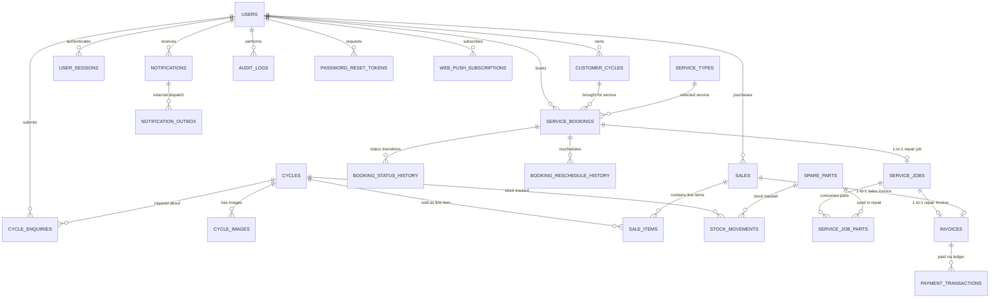

# SAFAR CYCLE — Database Relationships & Entity Relationship Diagram (ERD)

## 1. Overview
This document specifies the relational data model for SAFAR CYCLE. The database is implemented in **SQLite3** with strict foreign keys (`PRAGMA foreign_keys = ON`), WAL journaling (`PRAGMA journal_mode = WAL`), and isolated transactions.

All currency is stored as integer paise (`₹1.00 = 100 paise`), and timestamps are ISO-8601 UTC strings.

---

## 2. Mermaid Entity Relationship Diagram

---

## 3. Relationship Categories & Cardinalities

### 3.1 One-to-One (1:1) Relationships
1. **`service_bookings` <-> `service_jobs`**
   - **Primary Key / Foreign Key:** `service_jobs.booking_id` references `service_bookings.id` with a `UNIQUE` constraint.
   - **Rule:** A booking corresponds to at most one workshop repair job.
2. **`sales` <-> `invoices`**
   - **Primary Key / Foreign Key:** `invoices.sale_id` references `sales.id` with a `UNIQUE` constraint.
3. **`service_jobs` <-> `invoices`**
   - **Primary Key / Foreign Key:** `invoices.service_job_id` references `service_jobs.id` with a `UNIQUE` constraint.
   - **Mutual Exclusion Check Constraint:** `CHECK ((sale_id IS NOT NULL AND service_job_id IS NULL) OR (sale_id IS NULL AND service_job_id IS NOT NULL))` ensures an invoice represents strictly a cycle sale or a workshop repair, never both.

### 3.2 One-to-Many (1:N) Relationships
1. **`users` -> `customer_cycles`:** A customer can register multiple bicycles in their garage.
2. **`users` -> `service_bookings`:** A customer can submit multiple appointment requests over time.
3. **`service_bookings` -> `booking_status_history`:** Every status transition is logged append-only.
4. **`cycles` -> `cycle_images`:** A cycle can have multiple display photographs (`is_primary` flags the hero thumbnail).
5. **`sales` -> `sale_items`:** A sales receipt can contain multiple cycle purchases.
6. **`service_jobs` -> `service_job_parts`:** A repair job can consume multiple spare parts from workshop inventory.
7. **`invoices` -> `payment_transactions`:** In-person payments support partial installments (e.g. 50% deposit in Cash, remainder upon pickup via UPI).

---

## 4. Historical Snapshot Fields
To guarantee that catalogue price updates or product name revisions never alter completed historical business transactions, the following tables maintain immutable historical snapshots:

| Table | Snapshot Fields | Reason |
| :--- | :--- | :--- |
| `service_bookings` | `service_name_snapshot_en`, `service_name_snapshot_gu`, `cycle_name_snapshot`, `cycle_brand_snapshot` | Retains exact service and bicycle details at time of booking even if customer renames bike or service title changes. |
| `sale_items` | `sku_snapshot`, `product_name_snapshot`, `brand_snapshot`, `unit_price_paise`, `discount_paise`, `line_total_paise` | Preserves financial integrity and exact pricing of past sales. |
| `service_job_parts` | `part_name_snapshot`, `unit_price_paise`, `total_price_paise` | Workshop spare part billings remain immutable even if inventory retail prices change later. |

---

## 5. Foreign Key Deletion Restrictions

| Parent Entity | Dependent Entity | Action | Integrity Guarantee |
| :--- | :--- | :--- | :--- |
| `users` | `service_bookings`, `customer_cycles` | `ON DELETE RESTRICT` | Prevents deleting customer accounts that have active or historical workshop visits. |
| `cycles` | `sale_items`, `stock_movements` | `ON DELETE RESTRICT` | Cycles sold in the past cannot be erased from the physical sales ledger. |
| `spare_parts` | `service_job_parts`, `stock_movements` | `ON DELETE RESTRICT` | Spare parts utilized in repairs cannot be deleted. |
| `invoices` | `payment_transactions` | `ON DELETE RESTRICT` | Invoices with recorded financial payments cannot be deleted. |
| `users` | `user_sessions`, `notifications`, `password_reset_tokens` | `ON DELETE CASCADE` | Ephemeral user metadata cleans up when user is removed. |
| `cycles` | `cycle_images` | `ON DELETE CASCADE` | Cycle image records are deleted when an unpublished/draft cycle is purged. |
